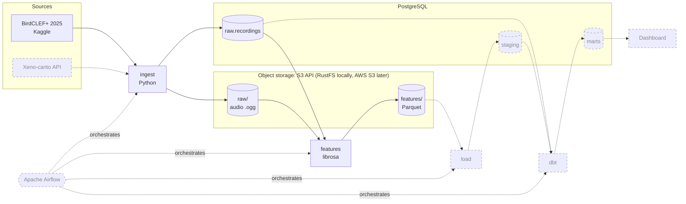

# Soundscape Data Pipeline

Data pipeline that processes field recordings from El Silencio Nature Reserve (Colombia).

> Work in progress. Data source and decisions: [docs/data_source.md](docs/data_source.md)

## Architecture



Solid lines and boxes are built; dashed ones are planned.

| Stage | Status | What it does |
|---|---|---|
| Ingest | ✅ Built | Uploads raw audio to S3 and registers its metadata in Postgres (idempotent by SHA-256) |
| Features | ✅ Built | Extracts audio features with librosa and writes Parquet partitioned by site and month |
| Load | Planned (E3) | Loads features from Parquet into Postgres staging |
| dbt | Planned (E4) | Staging and mart models with data quality tests |
| Dashboard | Planned (E4) | Soundscape by site and period |
| Airflow | Planned (E3) | Orchestrates ingest → features → load with retries |

## How to run

### 1. Prerequisites
- [Docker](https://docs.docker.com/get-docker/) with Docker Compose
- [uv](https://docs.astral.sh/uv/getting-started/installation/)
- A Kaggle API token ([how to get one](https://www.kaggle.com/docs/api)) saved in
  `~/.kaggle/access_token`, and the
  [competition rules](https://www.kaggle.com/competitions/birdclef-2025/rules) accepted

### 2. Install dependencies
```bash
uv sync
uv run pre-commit install   # enable the git hooks (once)
```

### 3. Download the data
```bash
uv run bash scripts/download_metadata.sh
uv run bash scripts/list_files.sh
uv run bash scripts/download_sample.sh   # 16 recordings (~8 MB) for local development
```

### 4. Start the services
```bash
cp .env.example .env    # then replace the placeholder secrets
docker compose up -d    # start PostgreSQL and RustFS
docker compose ps       # both services should be "healthy"
```

| Service | URL | Purpose |
|---|---|---|
| PostgreSQL 18 | `localhost:5432` | Recording metadata and audio features |
| RustFS (S3 API) | `http://localhost:9000` | Raw audio files (S3-compatible object storage) |
| RustFS console | http://localhost:9001/rustfs/console/ | Browse buckets in the browser |

Stop the services with `docker compose down`; data is kept in Docker volumes.
Why RustFS instead of MinIO: [ADR 0001](docs/adr/0001-s3-compatible-storage.md).

### 5. Run the ingestion
```bash
uv run python -m soundscape.ingest   # upload recordings to S3 and register them in Postgres
```
The ingestion is idempotent: re-running it skips recordings already registered
(by SHA-256). Files land in `s3://soundscape/raw/<source>/site=<site>/date=<date>/`
and their metadata in the `raw.recordings` table.

### 6. Extract audio features
```bash
uv run python -m soundscape.features   # write features to S3 as Parquet
```
One row per recording (MFCC, spectral centroid and bandwidth, RMS,
zero-crossing rate), partitioned in `s3://soundscape/features/site=<site>/month=<YYYY-MM>/`.
Recordings that cannot be decoded go to `features_failed/`.
Columns, types and units: [docs/features_schema.md](docs/features_schema.md).

### 7. Verify
```bash
docker compose exec postgres psql -U soundscape -d soundscape \
  -c "SELECT site_code, recorded_at, duration_s FROM raw.recordings ORDER BY recorded_at LIMIT 5;"
uv run pytest   # run the tests
```

## License
The code is released under the [MIT](LICENSE) license.

The data is **not** part of this repository nor covered by that license: the BirdCLEF+ 2025 dataset keeps its own [CC BY-NC-SA 4.0](https://creativecommons.org/licenses/by-nc-sa/4.0/) license (non-commercial use, with attribution). The pipeline downloads it directly from Kaggle.
